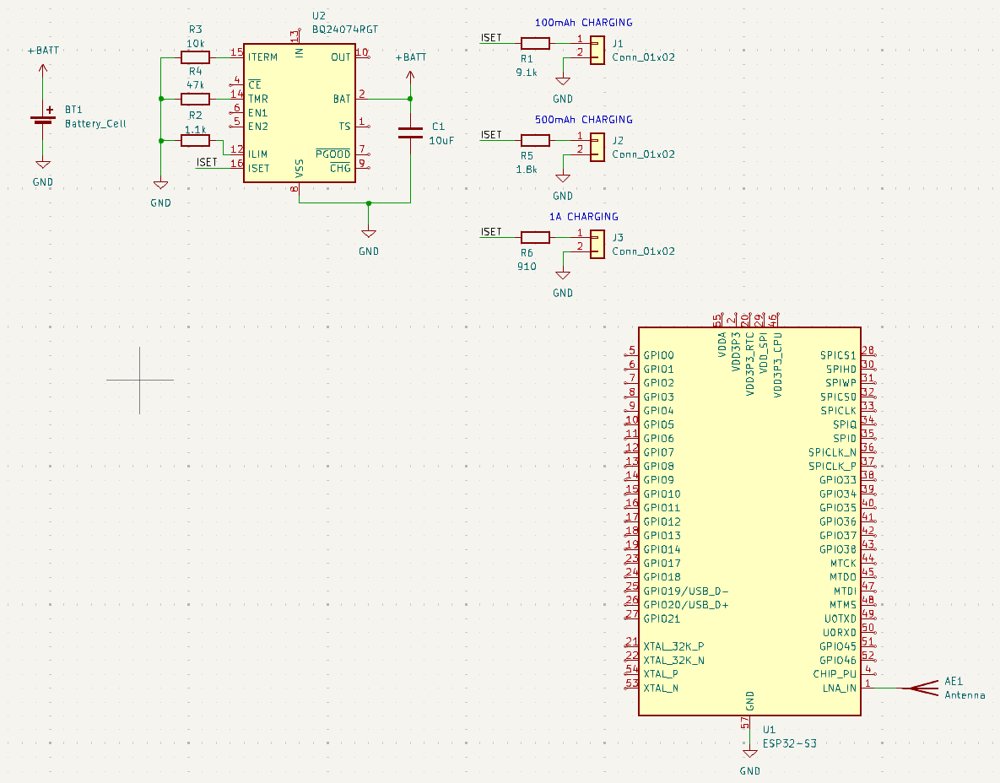
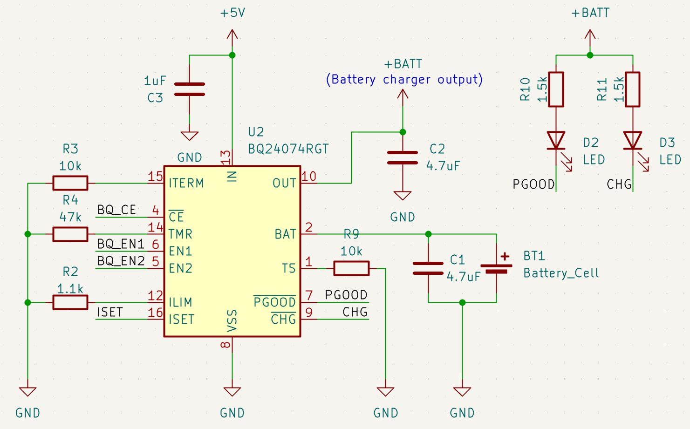
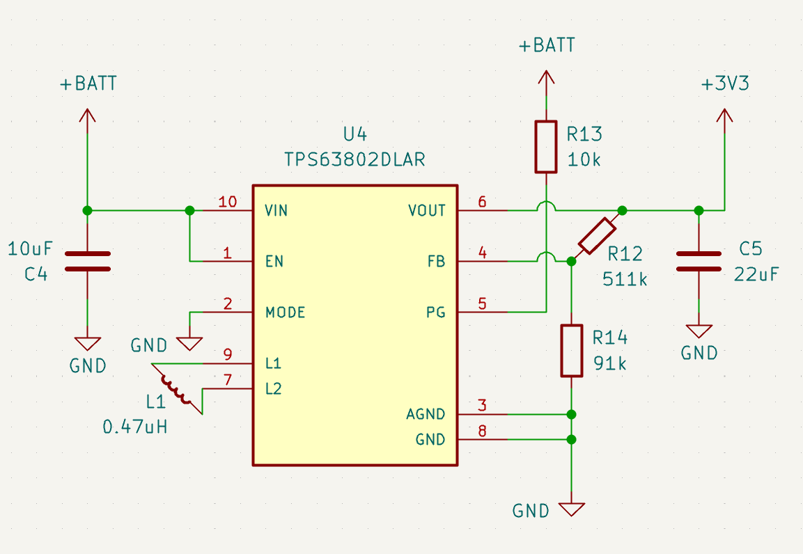
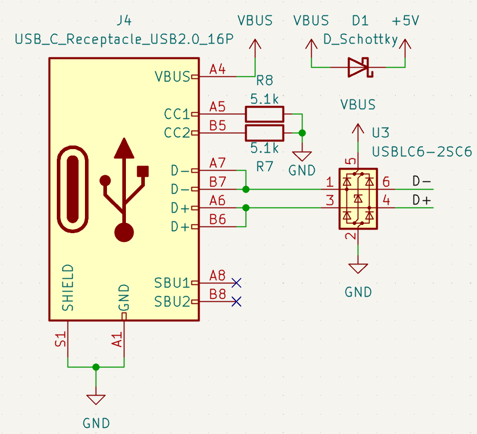
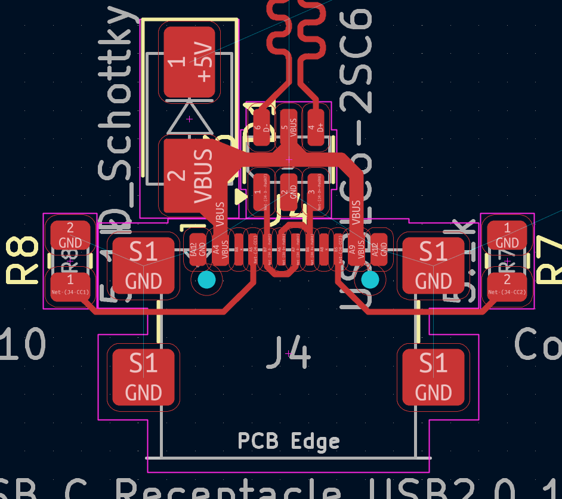
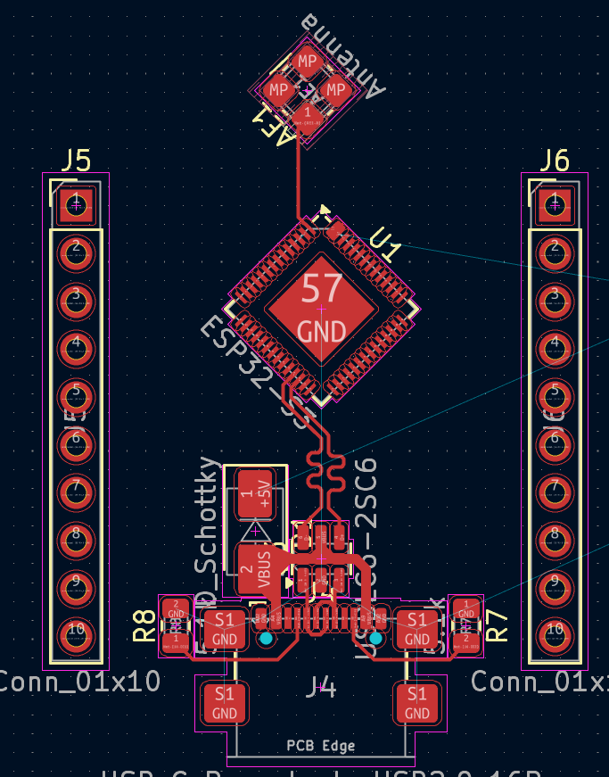
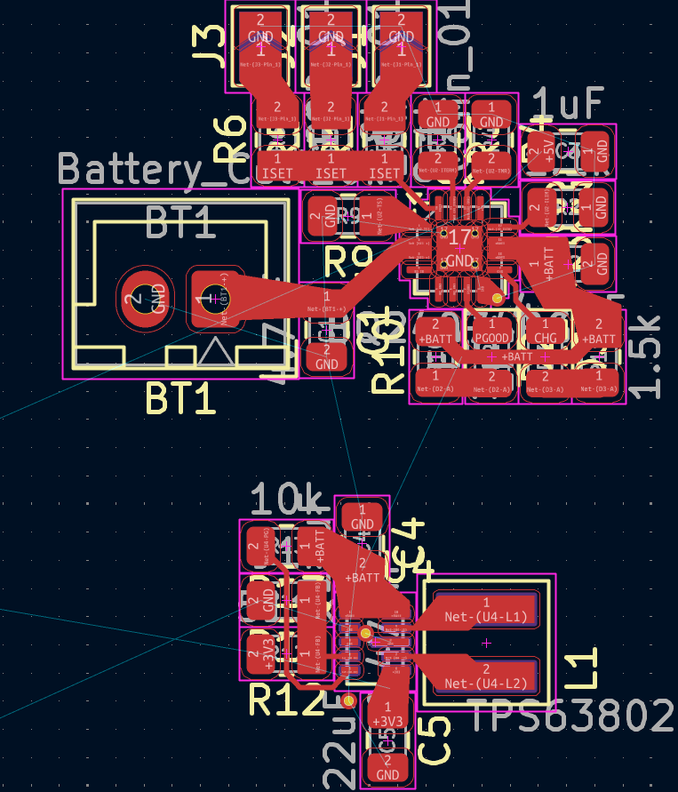

# Project Journal for the Anicept Venn

Here's my devlogs for the Venn!

## Day 1 - Fri, October 23

Today I got started on this project with the goal of a basic but powerful microcontroller that's small but has ample GPIO pins and peripheral outputs for most projects. After some research I decided to use the ESP32-S3, as it has both Wifi and BLE and is one of the more powerful ESP32 chips. This does make it somewhat more expensive, but I don't think it'll be too much of a problem. I want integrated battery charging like the ESP32 XIAO devboard line has, so I checked out some popular chip options. I quickly found [this](https://components101.com/articles/how-to-select-the-right-battery-charging-ic) site, and after perusal found the only chips listed with power path, a necessary feature that allows charging during usage were the BQ24074 and MAX8903, so I looked at each of those. While power path circuits can be made (pretty easily, really) externally, I thought it'd be best to find a chip with the native functionality for simplicity's sake. Power path is not one of those things that you really want to mess up. I found BQ24074 to be a popular choice, and I ended up using it mainly due to the handy USB support that a devboard could really use.

And so I found datasheets for the S3 and the BQ24074, and got to work. I found this really cool [hardware design guidelines sheet](https://docs.espressif.com/projects/esp-hardware-design-guidelines/en/latest/esp32s3/esp-hardware-design-guidelines-en-master-esp32s3.pdf) from Espressif about how to make a devboard with the S3, and I'm sure it'll prove to be useful. However I started first on the battery charger, using the datasheet [here](https://www.ti.com/lit/ds/symlink/bq24074.pdf). I really want to be more intentional on this project to understand everything I'm doing and not to blindly copy values or typical applications. For this reason I read pretty carefully through the datasheet, especially through the electrical characteristics and how resistor values impact ILIM, ISET, and ITERM, and what exactly distinguishes the three. After getting a good understanding, I began calculating my own resistor values for each (referencing a typical resistor value chart to make sure my values actually exist and are plentiful), and started to wonder how to add the functionality for dynamic charging rate with different-sized batteries.

Typical lipo (lithium polymer) batteries charge at about 1C rate, meaning a 500mAh battery charges at 500mA, and a 1.5Ah battery charges at 1.5 amps. The ISET value for the battery charging IC determines this rate, and if it too much exceeds 1C, it can damage the battery. I looked at some of Adafruit's battery chargers to see what they do, and found that they use a high-value resistor to produce a 100mA charging rate but give the user the ability to solder their own, lower-value resistor on and allow a higher charging rate. I dislike this for an entry-level, versatile devboard, as it adds extra hassle to what should be an unassuming process. The BQ24074 has two input pins from a microcontroller, that, when toggled specifically, edit the _ILIM_ value, which determines the maximum, power-source determined power draw, but there's nothing to dynamically change ISET, the specific battery power draw setting. So I decided to use some sort of solder bridge or pinheader jumper cap setup to enable a specific resistor, allowing the user to choose a value in a multiple of 500mA or so.

I contemplated adding something similar for dynamic ILIM adjustment, but deemed it unnecessary with the chip's innate ability to switch between 100mA, 500mA, or a resistor-determined value (I opted for 1.1kOhms, for about 1.4A, short of the BQ24074's 1.5A max).

Anyways, that's about it for today. Next I may finish the battery charger, break out some ESP32 GPIOs, and make the rest of its simpler connections! I'll have to think about what else to add to it peripheral-wise, since I do want it to be a simpler devboard.

### Worked ~1.75 hours

## Day 2 - Mon, November 16th

Welp, I've postponed this thing quite a lot, but I did a bunch more work on the battery side of the schematic and some preliminary wire routing. First, I finished the BQ24074 wiring, just with input/output caps, adding nets to pins, and adding status LEDs. I also researched how exactly the charger outputs voltage via power path, and how exactly to interface it with the buck/boost converter. After some digging around I found that when 5V USB is plugged in, the OUT pin gives off 4.2V protected max, regardless of whether the battery is charging or not. With USB unplugged, the battery provides whatever voltage it can (a range of 3V bare minimum to 4.2V fully charged, with 3.7V typical voltage) which is routed straight out the output.

I then began the boost/buck converter to turn the battery charger's 3-4.2v output into 3.3v—at first I planned to use the same converter that I had in my previous devboard design, but this time I decided to put actual effort into finding exactly the right one for this application. Previously I'd used the TPS63031, not at all a _bad_ chip, but after some googling I determined the TPS63802 to be a better choice. The 63802 doesn't have a preset 3.3v output, so it needs external configuration resistors, but that's perfectly fine given its far superior max continuous amperage and better features in efficiency and versatility for basically the same price.

So I found its datasheet, checked out the typical application and how to select resistors & the inductor, and wired the thing up. I had to do some research to find a good capacitor, as their recommended model isn't in stock at digikey. This wasn't too difficult, however, and the model I found (EXLA1V0402 R47) has all the recommended or greater values, such as max amperage and DC resistance (12.5A sat current, 6.8mΩ DCR for the EXLA vs the recommended 5.4A SC, 7.6mΩ DRC for the coilcraft).

Next I added the USB port! For this I did basically copy my last devboard components: a USBLC6-2SC6 protection chip, standard USBC-2.0, and a schottkey diode between VBUS (from the USB cable) to 5V (to the battery charger). I'd done good research on this diode previously, so I didn't feel the need to change it here.

After all this schematicizing, I imported everything into the PCB editor and began some routing! First I looked around for a good USB-C port on Digikey, and found a version with SMD shield pins, which look really interesting. I decided to go for it, so I'll theoretically have more room for B.Cu routing under the USB if necessary, and to more easily solder totally single-sided-ly. I arranged this, the protection IC, the schottkey diode, and the 5.1k CC resistors into the Optimal Configuration (I'm attempting to make this board totally single-sided; we'll see how long that lasts), and drew big fat polygon fills between power pins. I imported the ESP32-S3 footprint and some mock pinheaders (unconnected for now) to roughly bound the area, and quickly found out that space may be a bit of an issue. I drew some differential pairs from the USB to the ESP, and made a lil external antenna (one of those plug-in ones, not onboard) at the top of the board. I arranged all the battery-oriented features together, keeping caps close to their pins, and, referencing the typical layout of the TPS63802 and BQ24074 datasheets, organized them to provide the least resistance between vital connections. I routed everything, again, with polygons rather than traces, both to make it look nicer and to connect everything as closely as possible. So far I've been using 0805 footprints for resistors and capacitors, but given how much space I've already consumed, that may need to drastically change. I only fear for ease of assembly... in any case, I could always expand the board on the long axis (and add more pinheaders), although I'd prefer to keep it smaller.

I'll figure it out at some point. The next journal will probably be a while after this one, as I'm working on other projects at the moment.

### Worked 3 hours

