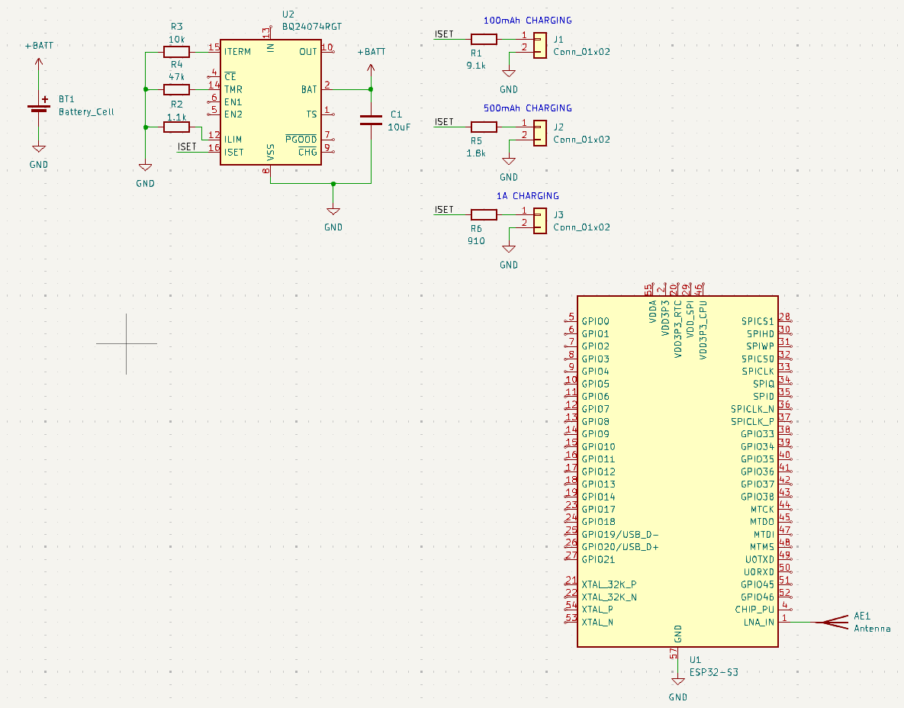

# Project Journal for the Anicept Venn

Here's my devlogs for the Venn!

## Day 1 - Fri, October 23

Today I got started on this project with the goal of a basic but powerful microcontroller that's small but has ample GPIO pins and peripheral outputs for most projects. After some research I decided to use the ESP32-S3, as it has both Wifi and BLE and is one of the more powerful ESP32 chips. This does make it somewhat more expensive, but I don't think it'll be too much of a problem. I want integrated battery charging like the ESP32 XIAO devboard line has, so I checked out some popular chip options. I quickly found [this](https://components101.com/articles/how-to-select-the-right-battery-charging-ic) site, and after perusal found the only chips listed with power path, a necessary feature that allows charging during usage were the BQ24074 and MAX8903, so I looked at each of those. While power path circuits can be made (pretty easily, really) externally, I thought it'd be best to find a chip with the native functionality for simplicity's sake. Power path is not one of those things that you really want to mess up. I found BQ24074 to be a popular choice, and I ended up using it mainly due to the handy USB support that a devboard could really use.

And so I found datasheets for the S3 and the BQ24074, and got to work. I found this really cool [hardware design guidelines sheet](https://docs.espressif.com/projects/esp-hardware-design-guidelines/en/latest/esp32s3/esp-hardware-design-guidelines-en-master-esp32s3.pdf) from Espressif about how to make a devboard with the S3, and I'm sure it'll prove to be useful. However I started first on the battery charger, using the datasheet [here](https://www.ti.com/lit/ds/symlink/bq24074.pdf). I really want to be more intentional on this project to understand everything I'm doing and not to blindly copy values or typical applications. For this reason I read pretty carefully through the datasheet, especially through the electrical characteristics and how resistor values impact ILIM, ISET, and ITERM, and what exactly distinguishes the three. After getting a good understanding, I began calculating my own resistor values for each (referencing a typical resistor value chart to make sure my values actually exist and are plentiful), and started to wonder how to add the functionality for dynamic charging rate with different-sized batteries.

Typical lipo (lithium polymer) batteries charge at about 1C rate, meaning a 500mAh battery charges at 500mA, and a 1.5Ah battery charges at 1.5 amps. The ISET value for the battery charging IC determines this rate, and if it too much exceeds 1C, it can damage the battery. I looked at some of Adafruit's battery chargers to see what they do, and found that they use a high-value resistor to produce a 100mA charging rate but give the user the ability to solder their own, lower-value resistor on and allow a higher charging rate. I dislike this for an entry-level, versatile devboard, as it adds extra hassle to what should be an unassuming process. The BQ24074 has two input pins from a microcontroller, that, when toggled specifically, edit the _ILIM_ value, which determines the maximum, power-source determined power draw, but there's nothing to dynamically change ISET, the specific battery power draw setting. So I decided to use some sort of solder bridge or pinheader jumper cap setup to enable a specific resistor, allowing the user to choose a value in a multiple of 500mA or so.

I contemplated adding something similar for dynamic ILIM adjustment, but deemed it unnecessary with the chip's innate ability to switch between 100mA, 500mA, or a resistor-determined value (I opted for 1.1kOhms, for about 1.4A, short of the BQ24074's 1.5A max).

Anyways, that's about it for today. Next I may finish the battery charger, break out some ESP32 GPIOs, and make the rest of its simpler connections! I'll have to think about what else to add to it peripheral-wise, since I do want it to be a simpler devboard.

### Worked ~1.75 hours

